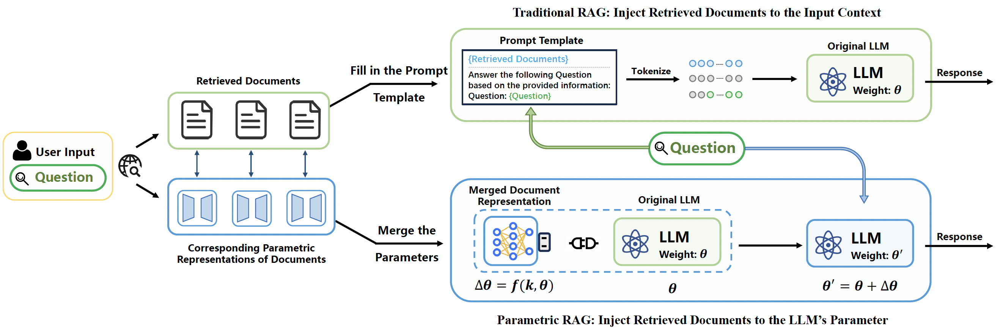
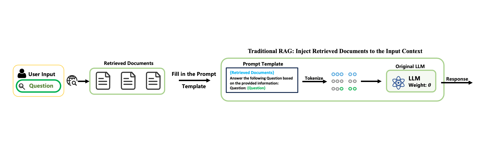
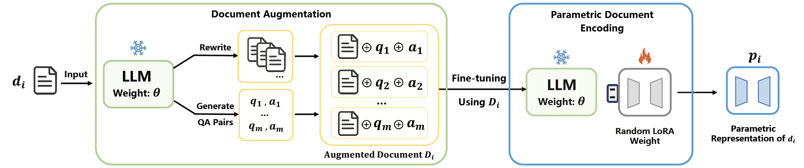

# Reproducibility Study of Parametric RAG

This repository is a copy of the [official Parametric RAG code](https://github.com/oneal2000/PRAG) (commit `43d7e14`)
with the additions used in our reproducibility study. The first commit is the unchanged original code; the second
commit contains all our changes (`git diff HEAD~1`). The original README follows below.

### Environments

All experiments use Python 3.10, `torch==1.13.1` and `transformers==4.44.2` (`requirements.txt`). The two
environments differ only in the peft version:

```
pip install -r requirements.txt                                # peft 0.13.2, as in the original code
pip install -r requirements.txt && pip install peft==0.21.0   # second environment
```

With peft 0.13.2, `model.unload()` keeps the configs of unloaded adapters, so from the second question on only the
adapter of the first passage is applied. peft 0.21.0 merges all adapters. Adapters are trained with peft 0.13.2.
Set `ROOT_DIR` in `src/root_dir_path.py` as described below.

### Data

- `data_aug.tar.gz`: the original augmented data (top-3 passages), unchanged.
- `data_aug_top20.tar.gz`: top-20 BM25 passages per question (same index, queries and augmentation prompts as the
  original), augmented with `llama3.2-1b-instruct`. As in the original, passages whose augmentation failed are
  skipped. Same 300 questions per dataset and type as `data_aug`.

### Added arguments

`src/encode.py`:

| Argument | Description |
|---|---|
| `--data_dir` | augmented data folder (default `data_aug`; `data_aug_top20` for the top-20 passages) |
| `--offline_dir` | adapter folder (default `offline`) |
| `--save_epochs` | e.g. `1,2,4`: save the adapters after each of these epochs |

`src/inference.py`:

| Argument | Description |
|---|---|
| `--inference_method vanilla` | the LLM without passages or adapters |
| `--exp_name` | extra output folder, `output/<exp_name>/...` |
| `--data_dir`, `--offline_dir` | as above |
| `--num_passages` | use only the top-n passages (and their adapters) |
| `--merge_strategy` | `cat` (original), `linear`, `ties`, `dare_linear` (peft `add_weighted_adapter`) |
| `--merge_weight` | weight per adapter: `one` (original, adapters summed), `inv_n` (1/n, averaged), `inv_n2` (1/n²; average-sized update for `linear` and `dare_linear`, which apply √w to A and B separately), `relevance` (softmax over cross-encoder scores) |
| `--merge_density`, `--merge_seed` | density for `ties`/`dare_linear`, seed for `dare_linear` |
| `--shuffle_adapters`, `--shuffle_passages`, `--shuffle_seed` | each question uses the adapters (`prag`) or passages (`icl`) of another question of the same dataset and type |
| `--relevance_dir` | scores for `--merge_weight relevance`, written by `src/score_passages.py` |

`src/score_passages.py` scores each question's passages with `cross-encoder/ms-marco-MiniLM-L-6-v2`:

```
python src/score_passages.py --dataset popqa --augment_model llama3.2-1b-instruct
```

Training and generation hyperparameters per model and dataset are those in `configs/`. Example: P-RAG with the
top-10 passages, adapters averaged (the top-20 adapters start from the same LoRA initialization as `offline/`):

```
mkdir -p offline-top20/llama3.2-1b-instruct/rank=2_alpha=32
cp -r offline/llama3.2-1b-instruct/rank=2_alpha=32/base_weight offline-top20/llama3.2-1b-instruct/rank=2_alpha=32/
python src/encode.py --model_name=llama3.2-1b-instruct --dataset=popqa --sample=300 --per_device_train_batch_size=1 \
    --num_train_epochs=2 --learning_rate=0.0003 --lora_rank=2 --lora_alpha=32 \
    --data_dir=data_aug_top20 --offline_dir=offline-top20
python src/inference.py --model_name=llama3.2-1b-instruct --dataset=popqa --sample=300 --num_train_epochs=2 \
    --learning_rate=0.0003 --lora_rank=2 --lora_alpha=32 --max_new_tokens=20 --inference_method=prag \
    --data_dir=data_aug_top20 --offline_dir=offline-top20 --num_passages=10 --merge_weight=inv_n --exp_name=top20-n10
```

---

# Parametric RAG

📢 **News: this work has been accepted at the SIGIR 2025!**







## Overview

**Welcome to the Official Repository of Parametric Retrieval-Augmented Generation (Parametric RAG)!**

This repository contains the code, datasets models used in our paper:
 **"Parametric Retrieval-Augmented Generation"**.


**If you find our project interesting or helpful, we would sincerely appreciate it if you could give us a star! Your support is a tremendous encouragement to us!**


#### What is Parametric RAG?

Parametric RAG introduces a new paradigm for retrieval-augmented generation by embedding external knowledge directly into the parametric space of Large Language Models (LLMs). This approach overcomes the limitations of traditional in-context RAG methods by:

- Reducing computational overhead by avoiding large context windows.

- Deeply integrating external knowledge into the Feed-Forward Networks (FFN) of LLMs for improved reasoning and synthesis.


#### What’s Included?

- End-to-end implementation of the Parametric RAG pipeline.
- Preprocessed benchmark datasets for experiments and scripts for customizing and adding new datasets.

## Reproduce Paper Results

In the following GitHub repository, we demonstrate how to test the performance of Parametric RAG on various QA datasets. Specifically, follow these steps to run Parametric RAG:

- **Run the Data Augmentation Module**: This step corresponds to Section 3.2.1 *Self-Augmentation* in the original paper, where documents are transformed into a data-augmented dataset.
- **Generate Parametric Representations of Documents**: This step corresponds to Section 3.2.2 *Additional Parameter Training* in the original paper, where additional LoRA parameters are trained.
- **Inference**: Merge the parametric representations of relevant documents, insert them into the LLM, and use the updated LLM for inference.

All the prompts used in the experiment are displayed in the `all_prompt.md` file.

### Install Environment

```
conda create -n prag python=3.10.4
conda activate prag
pip install torch==2.1.0
pip install -r requirements.txt
```

Please change the `ROOT_DIR` variable in `src/root_dir_path.py` to the folder address where you store PRAG.

### Self-Augmentation

You can directly use the pre-augmented data file `data_aug.tar.gz`. To extract it, run the command `tar -xzvf data_aug.tar.gz` in your terminal.

If you want to perform data augmentation yourself, please process it as follows.

#### Prepare BM25 for retrieval

1. Download the Wikipedia dump from the [DPR repository](https://github.com/facebookresearch/DPR/blob/main/dpr/data/download_data.py#L32) using the following command

```bash
mkdir -p data/dpr
wget -O data/dpr/psgs_w100.tsv.gz https://dl.fbaipublicfiles.com/dpr/wikipedia_split/psgs_w100.tsv.gz
pushd data/dpr
gzip -d psgs_w100.tsv.gz
popd
```

2. Use Elasticsearch to index the Wikipedia dump

```bash
cd data
wget -O elasticsearch-8.15.0.tar.gz https://artifacts.elastic.co/downloads/elasticsearch/elasticsearch-8.15.0-linux-x86_64.tar.gz  # download Elasticsearch
tar zxvf elasticsearch-8.15.0.tar.gz
rm elasticsearch-8.15.0.tar.gz 
cd elasticsearch-8.15.0
nohup bin/elasticsearch &  # run Elasticsearch in background
cd ../..
python prep_elastic.py --data_path data/dpr/psgs_w100.tsv --index_name wiki  # build index
```

#### Download dataset

For 2WikiMultihopQA:

Download the [2WikiMultihopQA](https://www.dropbox.com/s/ms2m13252h6xubs/data_ids_april7.zip?e=1) dataset from its repository <https://www.dropbox.com/s/ms2m13252h6xubs/data_ids_april7.zip?e=1>. Unzip it and move the folder to `data/2wikimultihopqa`.

For HotpotQA:

```bash
mkdir -p data/hotpotqa
wget -P data/hotpotqa/ http://curtis.ml.cmu.edu/datasets/hotpot/hotpot_dev_distractor_v1.json
```

For PopQA:

Download the [PopQA](https://github.com/AlexTMallen/adaptive-retrieval?tab=readme-ov-file#popqa) dataset from its repository <https://github.com/AlexTMallen/adaptive-retrieval/blob/main/data/popQA.tsv>, and put the file `popQA.tsv` into folder `data/popqa`.

```bash
mkdir -p data/popqa
wget -P data/popqa https://github.com/AlexTMallen/adaptive-retrieval/blob/main/data/popQA.tsv
```

For ComplexWebQuestions:

Download the [ComplexWebQuestions](https://www.tau-nlp.sites.tau.ac.il/compwebq) dataset from its repository <https://www.dropbox.com/scl/fo/nqujvpg2gc4y0ozkw3wgr/AOzjVEsdUhv2Fx2pamfJlSw?rlkey=746t7xehfqxf1zr867nxiq8aq&e=1>, and put the file `ComplexWebQuestions_dev.json` into folder `data/complexwebquestions`.

#### Data Augmentation:

```bash
python src/augment.py \
    --model_name llama3.2-1b-instruct \
    --dataset 2wikimultihopqa \
    --data_path data/2wikimultihopqa/ \
    --sample 300  \
    --topk 3
```

| **Parameter** | **Example/Options** |
| ------------------------------ | ---------------------------------------------------- |
| `model_name` | `llama3.2-1b-instruct`, `qwen2.5-1.5b-instruct`, `llama3-8b-instruct` |
| `dataset` | `2wikimultihopqa`, `hotpotqa`, `popqa`, `complexwebquestions` |
| `data_path` | folder to the saved data, such as `data/2wikimultihopqa` |
| `sample` | Number of questions to run |
| `topk` | retrieval number |

The results of data augmentation will be stored in the file `data_aug/{dataset}/{data_type}.json`.

If you want to apply data augmentation to a new dataset, the default data format for the augmented data is JSON. Each element in the array should include both a 'question' and an 'answer,' as shown in the example below.

```json
[
    {
        "question": "string",
        "answer": "string or list[string]",
    }
]
```

At this point, the input parameter `dataset` refers to the name of the dataset you’ve set, and `data_path` is the path to the JSON file mentioned above. The last filename in `data_path` will be treated as the `data_type`. The output file will be saved in `data_aug/{your_dataset_name}/{data_type}.json`.


### Document Parameterizing




By calling the `src/encode.py` file, you will generate a parameterized representation of the documents (LoRA) for the given dataset. The parameters for this file are as follows:

| **Parameter**                  | **Example/Options**                                  |
| ------------------------------ | ---------------------------------------------------- |
| `model_name`                   | `llama3.2-1b-instruct`, `qwen2.5-1.5b-instruct`, `llama3-8b-instruct` |
| `dataset`                      | `2wikimultihopqa`, `hotpotqa`, `popqa`, `complexwebquestions` |
| `data_type`                    | Not set means using the entire dataset, otherwise, specify a particular data type |
| `with_cot`                     | If included, generate a CoT |
| `sample`                        | Number of questions to run |
| `augment_model`                | Model used for data augmentation. If not set, the current model will be used for augmentation |
| `per_device_train_batch_size`, `num_train_epochs`, `learning_rate` | Training parameters |
| `lora_rank`, `lora_alpha`       | LoRA parameters, dropout will be set to 0 |

When running for the first time with a specific LoRA parameter, an initial random parameter, `base_weight` will be created. All subsequent training will start from this base_weight.

All generated parameters are stored in the `offline` folder. 
The specific location of the parameter files is as follows:

```plain
offline/
├── {model_name}/
│   └── rank={lora_rank}_alpha={lora_alpha}/
│       ├── base_weight/
│       └── {dataset}/
│           └── lr={learning_rate}_epoch={num_train_epochs}/
│               └── aug_model={augment_model}/
│                   └── {data_type}/
│                       └── data_{did}/
│                           └── passage_{pid}/
|                               └── parameters
```

The running parameters of the main experiments in the paper are listed in the `configs` folder.

### Generate

By calling the `src/inference.py` file, you will generate a parameterized representation of the documents (LoRA) for the given dataset. The parameters for this file are as follows:

| **Parameter**                  | **Example/Options**                                  |
| ------------------------------ | ---------------------------------------------------- |
| `model_name`                   | `llama3.2-1b-instruct`, `qwen2.5-1.5b-instruct`, `llama3-8b-instruct` |
| `dataset`                      | `2wikimultihopqa`, `hotpotqa`, `popqa`, `complexwebquestions` |
| `data_type`                    | Not set means using the entire dataset, otherwise, specify a particular data type |
| `with_cot`                     | If included, generate a CoT |
| `sample`                        | Number of questions to run |
| `augment_model`                | Model used for data augmentation. If not set, the current model will be used for augmentation |
| `per_device_train_batch_size`, `num_train_epochs`, `learning_rate` | Training parameters |
| `lora_rank`, `lora_alpha`       | LoRA parameters, dropout will be set to 0 |
| `max_new_tokens` | Number of generate tokens |
| `inference_method` | "icl" is naive RAG, "prag" is our method, and "combine" is using both methods together |

All generated results are stored in the `output` folder. The specific location of the parameter files is as follows:

```plain
offline/
├── {model_name}/
│   └── rank={lora_rank}_alpha={lora_alpha}/
│       └── {dataset}/
│           └── lr={learning_rate}_epoch={num_train_epochs}/
│               └── aug_model={augment_model}/
│                   └── {inference_method}/
│                       └── {data_type}/
│                           ├── config.json
│                           ├── predict.json
│                           └── result.txt
```

Also, the running parameters of the main experiments in the paper are listed in the `configs` folder.

## Warm up LoRA

After calling `python src/get_warmup_data.py`, the initialization training data for finetuning will be generated from the **latter** part of the dataset. The data generation code ensures that there is no data leakage. 

Then, the following code will be used to train and generate two base LoRA weights:


```bash
# the training used 600 data points 
python src/warmup_lora.py \
    --model_name llama3.2-1b-instruct \
    --per_device_train_batch_size 1 \
    --num_train_epochs 1 \
    --learning_rate 3e-4  \
    --block_size 3000 \
    --lora_rank 2 \
    --lora_alpha 32 \
    --with_cot 

# the training used 2000 data points  
python src/warmup_lora.py \
    --model_name llama3.2-1b-instruct \
    --per_device_train_batch_size 1 \
    --num_train_epochs 1 \
    --learning_rate 3e-4  \
    --lora_rank 2 \
    --lora_alpha 32 \
    --block_size 3000  
```
